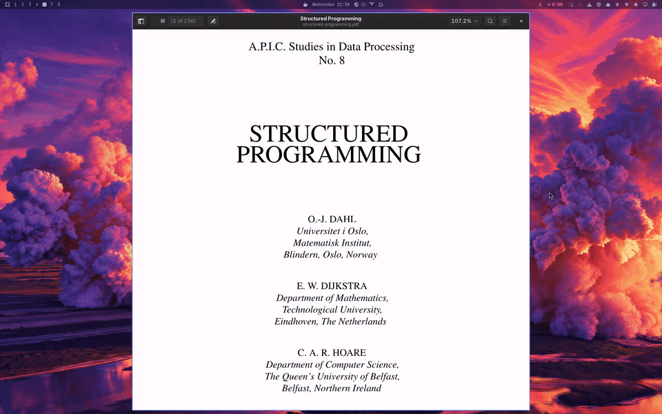
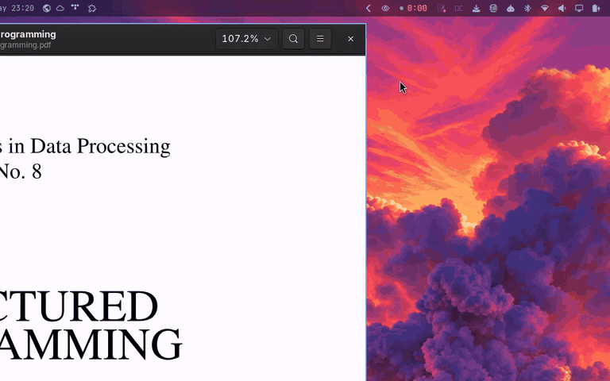

# Omarchy Focus Mode Plugin

A focus mode for Omarchy. One key press dims everything behind the focused
window, turns the wallpaper gray and hides the bar. The next press brings it
all back.



## Glossary

Service plugin
: The part of the plugin that runs focus mode. It lives inside the Omarchy
  shell, the one Quickshell process that also draws the bar and the
  notifications.

Bar widget
: The icon the plugin places in the bar. It opens a panel with the settings.

dim_around
: A Hyprland window property. The window it is set on stays as it is,
  everything behind it is darkened.

## What it does

- Darkens everything behind the focused window, other windows and the
  wallpaper alike. The darkening follows the focus to the next window.
- Shows the wallpaper and the border of the focused window in gray while
  focus mode is on.
- Hides the bar, and shows it again afterwards. A bar that was hidden before
  stays hidden.
- Fades in and out. With `omarchy toggle animations` off, it switches at once.
- Lets you set how strongly it dims and how gray the wallpaper turns, with a
  live preview.

## Install

```bash
omarchy plugin add https://github.com/AlexZeitler/omarchy-focus-mode-plugin.git --enable
omarchy restart shell
```

## Key binding

The plugin binds `SUPER + D` itself, as soon as the shell starts. `SUPER + D`
is free in a stock Omarchy.

If the key already has a binding, the plugin leaves it alone and binds
nothing. Your own binding always wins. The shell journal then says
`focus-mode: SUPER + D is taken, not binding it`.

### Another key

Set `key` on the plugin's entry in `~/.config/omarchy/shell.json`:

```json
{
  "id": "alexzeitler.focus-mode",
  "key": "SUPER + SHIFT + D"
}
```

The change applies on save. `"key": false` binds nothing.

### Binding the key yourself

If you would rather keep the binding in your Hyprland config, set
`"key": false` and add this line to `~/.config/hypr/bindings.lua`:

```lua
o.bind("SUPER + D", "Toggle focus mode", "omarchy-shell focus-mode toggle")
```

## Settings

Click the eye icon in the bar. The panel has two sliders and a switch:



Dim
: How dark everything behind the focused window gets, from 0% to 100%.
  70% by default.

Grayscale
: How much color the wallpaper and the border of the focused window lose,
  from 0% to 100%. 100% by default.

Gray border
: Whether the border of the focused window follows Grayscale. On by default.
  Switched off, the border keeps the theme's colors.

While the panel is open, the screen shows focus mode with the slider values.
The bar stays visible. Releasing a slider saves the value, closing the panel
ends the preview.

The values sit on the widget's entry in the bar layout of
`~/.config/omarchy/shell.json`. `dim` and `grayscale` are numbers between 0
and 1:

```json
{
  "id": "alexzeitler.focus-mode",
  "dim": 0.7,
  "grayscale": 1,
  "grayscaleBorder": true
}
```

They also work without the bar widget, on the plugin's entry in `plugins`.
Changes to the file apply on save, even while focus mode is on.

## Works best with a single square window

Focus mode works best together with Omarchy's single-window square aspect.
Press `SUPER + CTRL + BACKSPACE` to toggle it. A lone window then no longer
spans the whole screen, and the gray wallpaper shows on both sides of it.

## Control

```bash
omarchy-shell focus-mode toggle
omarchy-shell focus-mode on
omarchy-shell focus-mode off
omarchy-shell focus-mode status
```

## Limits

- A video background keeps its colors. Another program draws it, and the
  plugin only grays still images.
- The state is not kept. After a restart of the shell, focus mode is off.
- On a workspace without windows, only the wallpaper turns gray. There is no
  focused window to darken around.

## Remove

```bash
omarchy plugin remove alexzeitler.focus-mode
```

If you bound the key yourself, delete the line from
`~/.config/hypr/bindings.lua` as well.
